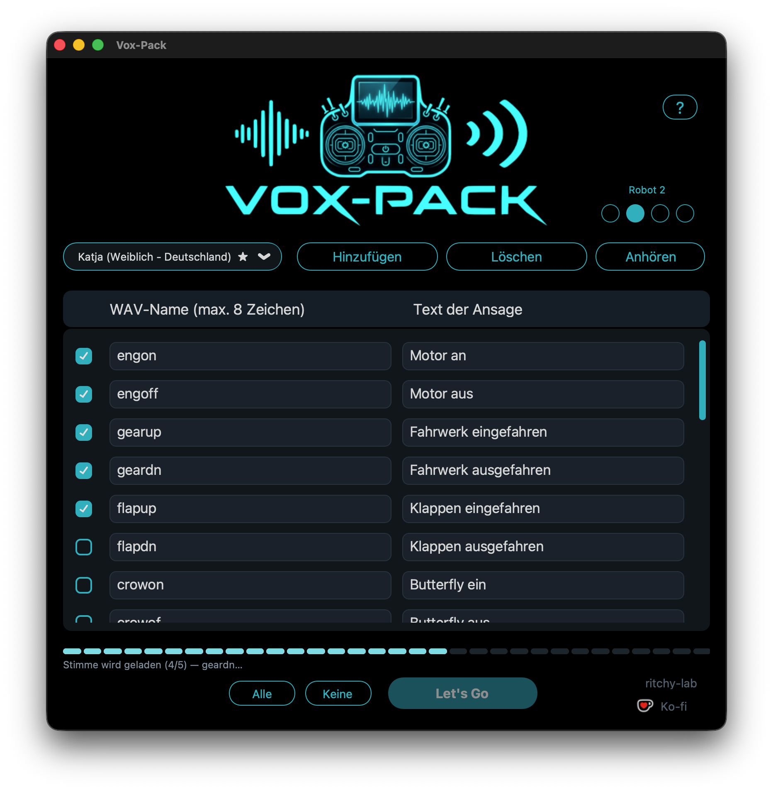
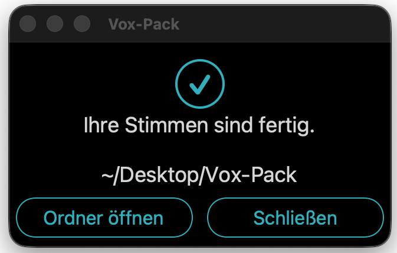
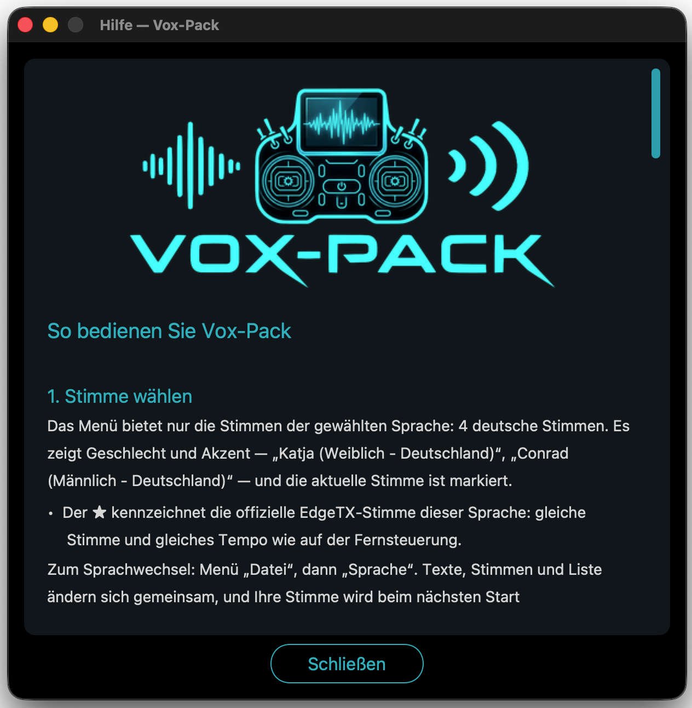

🇫🇷 **[Version française](README.md)** · 🇬🇧 **[English version](README.en.md)**

# Vox-Pack

**Geben Sie Ihrer Fernsteuerung eine Stimme.**

Vox-Pack erzeugt die Ansagen, die Ihre EdgeTX-Fernsteuerung im Flug spricht:
„Motor an“, „Fahrwerk ausgefahren“, „Timer gestartet“ …

Sie schreiben Ihre Sätze, wählen eine Stimme und drücken **Let's Go**. Die
Anwendung erzeugt die Dateien in genau dem Format, das EdgeTX erwartet
(16 Bit, 32 kHz, mono), fertig zum Kopieren auf die SD-Karte der Fernsteuerung.

## So sieht es aus

Sie schreiben Ihre Sätze, wählen eine Stimme, markieren die Zeilen zum
Erzeugen und drücken **Let's Go**.

Zwei Klicks später liegt ein Ordner mit `.wav`-Dateien bereit. Die Anwendung
sagt Ihnen immer, **wohin** sie geschrieben hat — und **was schiefgegangen**
ist.

Und sie erklärt sich selbst: Die Schaltfläche **?** oben rechts öffnet diese
Hilfe.

## So funktioniert es

1. **Stimme wählen.** Es gibt **34**: 11 französische (Frankreich, Schweiz,
   Belgien, Québec), 19 englische (USA, Großbritannien, Irland) und 4 deutsche.
   Das Menü zeigt den Akzent — „Katja (Weiblich - Deutschland)“, „Ryan (Männlich
   - Großbritannien)“ —, die aktuelle Stimme ist markiert, und **★** kennzeichnet
   die offizielle Stimme von EdgeTX (Denise für Französisch, Emily für Englisch,
   Katja für Deutsch).
2. **Sätze schreiben.** Die Liste ist mit gängigen Ansagen vorbereitet — 28 auf
   Deutsch, 44 auf Französisch und Englisch (Motor, Klappen, Fahrwerk, Timer,
   Flugmodi …). Jede Zeile lässt sich ändern, ergänzen oder löschen.
3. **Markieren** Sie die gewünschten Zeilen, oder klicken Sie auf **Alle**.
   Mehrere auf einmal: erst das erste Kästchen anklicken, dann **Umschalt +
   Klick** auf das letzte.
4. **Let's Go drücken** und einen Ordner wählen: Die `.wav`-Dateien entstehen.

Die Schaltfläche **Anhören** spielt **alle markierten Zeilen** nacheinander ab,
bevor Sie etwas erzeugen.

Während des Erzeugens zeigt eine **Statuszeile** unter der Fortschrittsanzeige
jederzeit, was die Anwendung gerade tut: Stimme laden, dann die Datei schreiben.

Ihre Liste wird automatisch gespeichert — Sie finden sie beim nächsten Start
wieder.

## Pausen in einer Ansage

Ein **`>`** im Satz erzeugt eine Pause: jedes `>` zählt eine halbe Sekunde,
`>>` also eine ganze, `>>>` eineinhalb. Am Satzanfang verzögert sie die Ansage
(„`>>>` Motor an“), zwischen zwei Wörtern trennt sie sie („Motor an `>>` Motor
aus“). Höchstens zehn Sekunden. Sichtbar ist das Zeichen nur in der Liste, in
der Ansage hört man nur die Pause.

## System-Ansagen von EdgeTX

Das Menü **Datei → System-Ansagen erzeugen…** baut die **186 offiziellen
SYSTEM-Dateien** auf Französisch (**212** auf Englisch, **211** auf Deutsch) mit
der gewählten Stimme, in einem Ordner `SYSTEM/` zum Kopieren auf die SD-Karte.
Die Liste stammt aus dem offiziellen EdgeTX-Depot und wird nicht verändert; Ihre
Sätze, Ihre Liste und Ihre Einstellungen bleiben unberührt.

## Roboterstimmen und HAL 9000

Rechts im Fenster verwandeln **drei Punkte Roboter 1 bis 3 und der Punkt
HAL 9000** die gewählte Stimme. Kein Punkt markiert: die normale Stimme. Klicken
Sie auf einen Punkt und dann auf **Anhören**; ein erneuter Klick auf den
leuchtenden Punkt bringt die normale Stimme zurück. Der Effekt gilt auch für die
Listendateien und die System-Ansagen.

## Updates

Beim Start prüft die Anwendung still, ob auf der Releases-Seite eine neuere
Version erschienen ist. Wenn ja, bietet ein kleines Fenster den Download direkt
in Ihren Downloads-Ordner an und öffnet den Ordner; sonst erscheint nichts. Ohne
Internetverbindung passiert nichts.

## Die Sprache der Anwendung

Die Anwendung gibt es **auf Französisch, Englisch und Deutsch**. Sie startet in
der Sprache Ihres Computers, und Sie können sie jederzeit unter
**Datei → Sprache** wechseln.

Diese Wahl bestimmt **alles gleichzeitig**: die Texte, die angebotenen Stimmen
und die Liste der Sätze. Und **jede Sprache behält ihre eigene Liste**: Sie
können auf Französisch arbeiten, auf Englisch wechseln und zurückkommen — **Ihre
Arbeit ist noch da**.

## Was erzeugt wird

- **WAV PCM 16 Bit, 32 kHz, mono** — das Format, das EdgeTX liest.
- Eine Datei pro Satz, benannt nach der linken Spalte (`engon.wav`,
  `gearup.wav` …), in einem Unterordner **Vox-Pack**.
- ⚠️ Dateinamen sind auf **8 Zeichen** begrenzt, ohne Akzent und ohne Leerzeichen
  (nur Buchstaben, Ziffern, `-` und `_`). Auf einem **EdgeTX älter als 2.11**
  werden auf Farb-Fernsteuerungen und kleinen Schwarz-Weiß-Geräten nur **6
  Zeichen** gelesen — X9D und X9E lesen auch vorher 8. **Im Zweifel bei 6
  Zeichen bleiben**: So wird es auf jeder Fernsteuerung und in jeder Version
  gelesen.
- Die Dateien kommen in einen Ordner, den Sie auf die SD-Karte kopieren, nach
  `SOUNDS/de` (oder `SOUNDS/fr`, `SOUNDS/en`).

## Die Liste verwalten

Das Menü **Datei** erlaubt Ihnen:

- die Liste in eine Datei **exportieren**, zum Aufbewahren oder Weitergeben;
- eine vorhandene Liste **importieren**: ein Name und ein Satz pro Zeile, durch
  ein Komma getrennt. Die Anwendung fragt vorher nach;
- die **Standardliste laden**, die mit der Anwendung geliefert wird, in der
  Sprache Ihrer Stimmen.

## Voraussetzungen

- **macOS 11 oder neuer** (Apple Silicon) oder **Windows 10 oder neuer**.
- **Eine Internetverbindung**: Die Stimmen werden vom Onlinedienst von Microsoft
  Edge erzeugt. Der Text Ihrer Sätze wird beim Erzeugen an Microsoft gesendet.
  Ohne Verbindung entsteht keine Stimme.
- **Die Stimmen** kommen über `edge-tts` (inoffiziell) vom **Microsoft-Edge-
  Dienst**. Vox-Pack verteilt keine Stimmen; der Text wird beim Erzeugen an
  Microsoft gesendet.
- Python 3.10 oder neuer, nur bei der Installation aus dem Quellcode.

## Installation

### macOS

1. Laden Sie **`Vox-Pack.zip`** von der
   [Releases](https://github.com/ritchy-lab/Vox-Pack/releases)-Seite und
   entpacken Sie es.
2. Ziehen Sie **Vox-Pack.app** in Ihren Ordner **Programme**.

3. **Beim allerersten Start verweigert macOS das Öffnen**: Die Anwendung stammt
   nicht aus dem App Store und hat kein Apple-Zertifikat (es kostet 99 € im
   Jahr). Zwei Wege:

   **a) Rechtsklick → Öffnen** auf die Anwendung, dann bestätigen.
   *(Bei den neuesten macOS-Versionen funktioniert das nicht mehr.)*

   **b) Systemeinstellungen → Datenschutz & Sicherheit**, nach unten zum
   Hinweis über **Vox-Pack** scrollen, dann **„Trotzdem öffnen“** klicken. Mit
   Passwort oder Touch ID bestätigen.

   **Das ist einmalig.** Danach genügt ein normaler Doppelklick.

Wenn macOS behauptet, die Anwendung sei „beschädigt“

Diese Meldung ist irreführend — nichts ist kaputt. Sie ist die Folge des
fehlenden Apple-Zertifikats. Öffnen Sie **Terminal**, fügen Sie diese Zeile ein
und starten Sie die Anwendung erneut:

    xattr -dr com.apple.quarantine /Applications/Vox-Pack.app

### Windows

1. Laden Sie **`Vox-Pack.exe`** von der
   [Releases](https://github.com/ritchy-lab/Vox-Pack/releases)-Seite.
2. Doppelklick. Windows zeigt **„Der Computer wurde durch Windows geschützt“**:
   auf **Weitere Informationen** und dann auf **Trotzdem ausführen** klicken.

   Auch das liegt an der fehlenden Signatur. Die Anwendung verlangt keine
   besonderen Rechte: Sie legt die `.wav`-Dateien im gewählten Ordner an.

## Installation aus dem Quellcode

    python3.11 -m venv venv
    venv/bin/python -m pip install -r requirements.txt
    venv/bin/python voxpack.py

Um die macOS-Anwendung (`Vox-Pack.app`) und ihr Release-Zip zu bauen:

    ./build.sh

Das Skript baut in einem temporären Ordner, entfernt die Finder-Attribute,
signiert das Bündel, erzeugt das Zip und prüft es durch Entpacken — das Rezept,
das die Warnung „beschädigt“ vermeidet.

## Wo liegt meine Liste?

    ~/Documents/Vox-Pack/liste_fr.csv     (französische Liste)
    ~/Documents/Vox-Pack/liste_en.csv     (englische Liste)
    ~/Documents/Vox-Pack/liste_de.csv     (deutsche Liste)

Eine Liste pro Sprache. Wenn Sie die frühere Version (RadioVox) benutzt haben,
wird Ihre Liste beim ersten Start automatisch als französische Liste übernommen.
Der alte Ordner wird nie gelöscht.

## Hilfe

Die Anwendung erklärt sich selbst: Klicken Sie auf **?** oben rechts.

## Hinweise

- Die Stimmen kommen vom Dienst **edge-tts**, der auf der Sprachsynthese von
  Microsoft Edge beruht. Vox-Pack wandelt sie nur in das richtige Format um.
- Beim Start **prüft die Anwendung, ob die angebotenen Stimmen bei Microsoft
  noch existieren**, und entfernt die verschwundenen. Schlägt diese Prüfung fehl
  (keine Verbindung), bleibt die Liste unverändert.
- Der Dienst von Microsoft kann sich ohne Vorwarnung ändern: Wenn das Erzeugen
  plötzlich mit einem Fehler abbricht, muss fast immer die Bibliothek
  `edge-tts` aktualisiert werden (`pip install --upgrade edge-tts`).
- Vox-Pack ist ein **unabhängiges** Werkzeug. Es wird vom EdgeTX-Team weder
  veröffentlicht noch empfohlen.

## Das Projekt unterstützen

Wenn Ihnen dieses Werkzeug nützt, können Sie
[mir einen Kaffee spendieren ☕](https://ko-fi.com/ritchy_lab).

## Lizenz

MIT — siehe die Datei [LICENSE](LICENSE).

---

gemacht von ritchy
