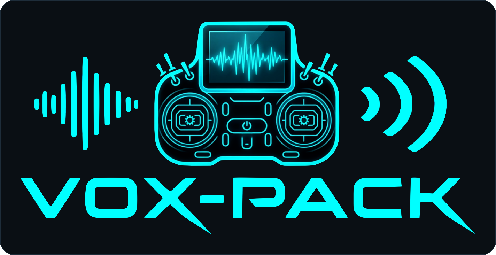
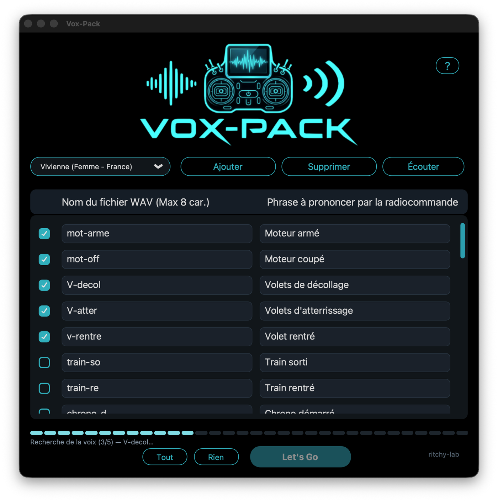
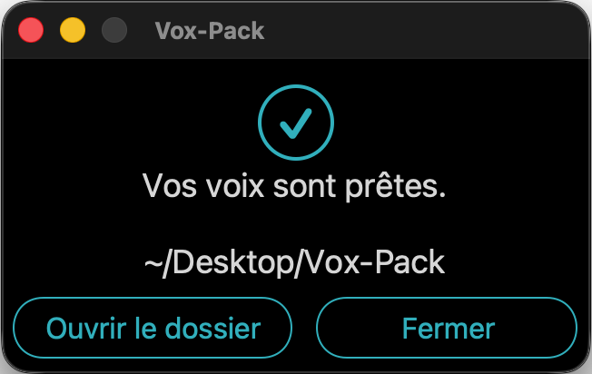
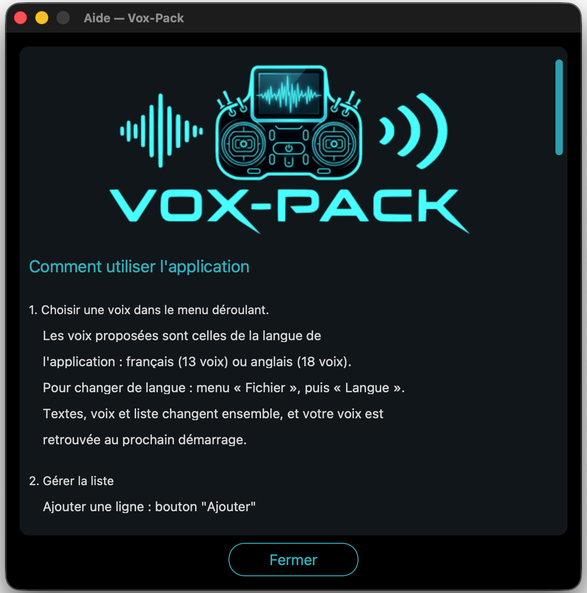

🇬🇧 **[English version](README.en.md)**

# Vox-Pack

**Fait parler ta radiocommande.**

Vox-Pack fabrique les fichiers de voix que ta radio EdgeTX prononce pendant
le vol : « Moteur armé », « Train sorti », « Chrono démarré »…

Tu écris tes phrases, tu choisis une voix, tu appuies sur **Let's Go**.
L'application crée les fichiers au format exact attendu par EdgeTX
(16 bits, 32 kHz, mono), prêts à copier sur la carte SD de la radio.

## À quoi ça ressemble

Tu écris tes phrases, tu choisis une voix, tu coches les lignes à générer, et
tu appuies sur **Let's Go**.

Deux clics plus tard, un dossier de fichiers `.wav` prêts pour la radio.
L'application te dit toujours **où** elle a écrit, et **ce qui a pu échouer**.

Et elle explique elle-même comment s'en servir : le bouton **?** en haut à
droite ouvre cette aide.

## Comment ça marche

1. **Choisis une voix.** Il y en a **31** : 13 en français (France, Suisse,
   Belgique, Québec) et 18 en anglais (États-Unis, Royaume-Uni). Le menu
   indique l'accent — « Denise (Femme - France) », « Ryan (Homme -
   Royaume-Uni) » — et **la voix en cours est cochée** dans la liste.
2. **Écris tes phrases.** La liste est pré-remplie avec 44 annonces courantes
   (moteur, volets, train, chrono, modes de vol…). Tu peux tout modifier,
   ajouter ou supprimer des lignes.
3. **Coche** les lignes que tu veux générer, ou clique sur **Tout**. Pour en
   cocher plusieurs d'un coup : clique sur la première case, puis
   **Majuscule + clic** sur la dernière.
4. **Appuie sur Let's Go**, choisis un dossier : les fichiers `.wav` sont créés.

Le bouton **Écouter** fait entendre **toutes les lignes cochées**, l'une après
l'autre, avant de générer quoi que ce soit.

Pendant la génération, une **ligne d'état** — sous la barre de progression —
indique à chaque instant ce que fait l'application : recherche de la voix,
puis écriture du fichier.

Ta liste est enregistrée automatiquement : tu la retrouves au prochain
démarrage, et tu peux la faire évoluer petit à petit.

## La langue de l'application

L'application existe **en français et en anglais**. Elle démarre dans la
langue de ton ordinateur, et tu peux en changer quand tu veux dans
**Fichier → Langue**.

Ce choix commande **les trois à la fois** : les textes, les voix proposées,
et la liste de phrases. Et **chaque langue garde sa propre liste** : tu peux
travailler en français, passer en anglais, puis revenir — **tu retrouves ton
travail intact**.

## Ce que l'application produit

- Format **WAV PCM 16 bits, 32 kHz, mono** — le format lu par EdgeTX.
- Un fichier par phrase, nommé d'après la colonne de gauche
  (`mot-arme.wav`, `train-so.wav`…), dans un sous-dossier **Vox-Pack**.
- ⚠️ Le nom du fichier est limité à **8 caractères**, sans accent et sans
  espace (lettres, chiffres, `-` et `_` uniquement).
  Sur un **EdgeTX antérieur à la 2.11**, seuls **6 caractères** sont lus sur
  les radios couleur et les petites radios noir et blanc — les X9D et X9E
  acceptent 8 même avant. **En cas de doute, reste à 6 caractères** : ce sera
  lu sur toutes les radios et toutes les versions.
- Les fichiers sont rangés dans un dossier que tu copies ensuite sur la carte
  SD, dans `SOUNDS/fr` (ou `SOUNDS/en`).

## Gérer ta liste

Le menu **Fichier** permet de :

- **Exporter** ta liste dans un fichier, pour la sauvegarder ou la partager ;
- **Importer** une liste existante : un nom et une phrase par ligne, séparés
  par une virgule. L'application demande confirmation avant de remplacer ;
- **Charger la liste par défaut**, celle livrée avec l'application, dans la
  langue de tes voix.

## Prérequis

- **macOS 11 ou plus récent** (Apple Silicon) ou **Windows 10 ou plus récent**.
- **Une connexion Internet** : les voix sont synthétisées par le service en
  ligne de Microsoft Edge. Le texte de tes phrases est donc envoyé à Microsoft
  au moment de la génération. Sans connexion, aucune voix ne peut être créée.
- Python 3.10 ou supérieur uniquement si tu installes depuis les sources.

## Installation

### macOS

1. Télécharge **`Vox-Pack.zip`** depuis la page
   [Releases](https://github.com/ritchy-lab/Vox-Pack/releases) et décompresse-le.
2. Glisse **Vox-Pack.app** dans ton dossier **Applications**.

3. **Au tout premier lancement, macOS refusera de l'ouvrir** : l'application
   ne vient pas de l'App Store et n'a pas de certificat Apple (il coûte 99 €
   par an). Deux façons de l'autoriser :

   **a) Clic droit → Ouvrir** sur l'application, puis confirme.
   *(Sur les macOS les plus récents, cette méthode ne suffit plus.)*

   **b) Réglages Système → Confidentialité et sécurité**, descends jusqu'au
   message qui parle de **Vox-Pack**, puis clique sur **« Ouvrir quand même »**.
   Confirme avec ton mot de passe ou Touch ID.

   **C'est à faire une seule fois.** Ensuite, un double-clic normal suffira.

Si macOS affirme que l'application est « endommagée »

Ce message est trompeur — l'application n'a rien de cassé. C'est la
conséquence de l'absence de certificat Apple. Ouvre le **Terminal**, colle
cette ligne, puis relance l'application :

    xattr -dr com.apple.quarantine /Applications/Vox-Pack.app

### Windows

1. Télécharge **`Vox-Pack.exe`** depuis la page
   [Releases](https://github.com/ritchy-lab/Vox-Pack/releases).
2. Double-clique dessus. Windows affiche **« Windows a protégé votre
   ordinateur »** : clique sur **Informations complémentaires**, puis sur
   **Exécuter quand même**.

   Là encore, c'est parce que l'application n'est pas signée. Elle ne demande
   aucun droit particulier : elle crée juste les fichiers `.wav` dans le
   dossier que tu choisis.

## Installation depuis les sources

    python3.11 -m venv venv
    venv/bin/python -m pip install -r requirements.txt
    venv/bin/python voxpack.py

Pour fabriquer l'application macOS (`Vox-Pack.app`) et son zip de publication :

    ./build.sh

Le script compile dans un dossier temporaire, nettoie les attributs du Finder,
signe le paquet, fabrique le zip puis le vérifie en l'extrayant — c'est la
recette qui évite l'avertissement « application endommagée ».

## Où est rangée ma liste ?

    ~/Documents/Vox-Pack/liste_fr.csv     (liste française)
    ~/Documents/Vox-Pack/liste_en.csv     (liste anglaise)

Une liste par langue. Si tu utilisais la version précédente (RadioVox), ta
liste est reprise automatiquement comme liste française au premier démarrage.
L'ancien dossier n'est jamais supprimé.

## L'aide

L'application explique elle-même comment l'utiliser : clique sur le **?** en
haut à droite.

## Notes

- Les voix sont celles du service **edge-tts**, qui s'appuie sur la synthèse
  vocale de Microsoft Edge. Vox-Pack ne fait que les mettre au bon format.
- Au démarrage, l'application **vérifie que les voix proposées existent
  toujours** chez Microsoft et retire celles qui ont disparu. Si la
  vérification échoue (pas de connexion), la liste reste telle quelle.
- Le service de Microsoft peut changer sans préavis : si la génération
  s'arrête d'un coup avec une erreur, c'est presque toujours que la
  bibliothèque `edge-tts` doit être mise à jour (`pip install --upgrade edge-tts`).
- Vox-Pack est un outil **indépendant**. Il n'est ni édité ni approuvé par
  l'équipe EdgeTX.

## Soutenir le projet

Cet utilitaire te sert ou te plaît ? Tu peux
[m'offrir un café ☕](https://ko-fi.com/ritchy_lab).

## Licence

MIT — voir le fichier [LICENSE](LICENSE).

---

made by ritchy
