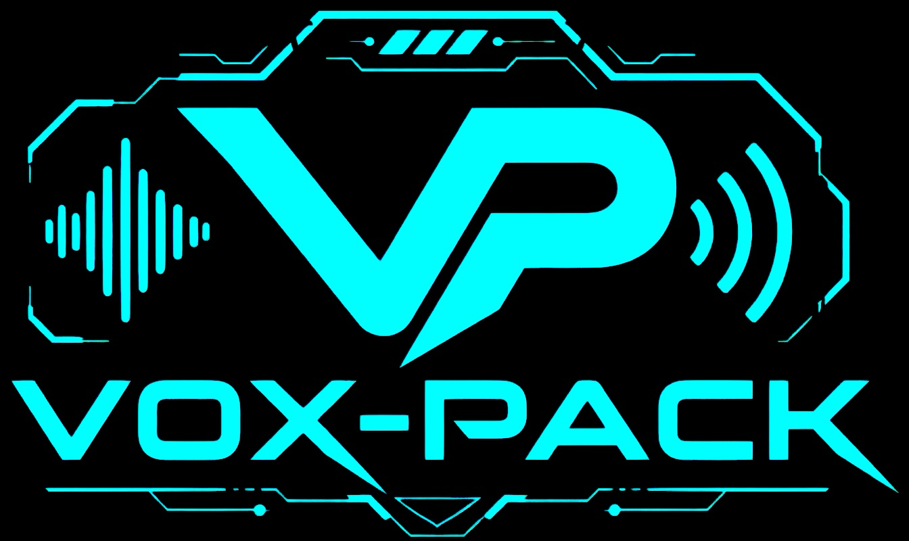

🇬🇧 **[English version](README.en.md)**

# Vox-Pack

**Fait parler ta radiocommande.**

Vox-Pack fabrique les fichiers de voix que ta radio EdgeTX prononce pendant
le vol : « Moteur armé », « Train sorti », « Chrono démarré »…

Tu écris tes phrases, tu choisis une voix, tu appuies sur **Let's Go**.
L'application crée les fichiers au format exact attendu par EdgeTX
(16 bits, 32 kHz, mono), prêts à copier sur la carte SD de la radio.

## Comment ça marche

1. **Choisis une voix** dans le menu déroulant (Denise, Ariane, Henri, Fabrice).
2. **Écris tes phrases.** La liste est pré-remplie avec 44 annonces courantes
   (moteur, volets, train, chrono, modes de vol…). Tu peux tout modifier,
   ajouter ou supprimer des lignes.
3. **Coche** les lignes que tu veux générer, ou clique sur **Tout**.
4. **Appuie sur Let's Go**, choisis un dossier : les fichiers `.wav` sont créés.

Un bouton **Écouter l'aperçu** permet d'entendre une phrase avant de générer.

Ta liste est enregistrée automatiquement : tu la retrouves au prochain
démarrage, et tu peux la faire évoluer petit à petit.

## Ce que l'application produit

- Format **WAV PCM 16 bits, 32 kHz, mono** — le format lu par EdgeTX.
- Un fichier par phrase, nommé d'après la colonne de gauche
  (`mot-arme.wav`, `train-so.wav`…), dans un sous-dossier **Voix radio**.
- ⚠️ Le nom du fichier doit rester **court** : la longueur acceptée dépend de
  la radio (6 caractères sur la plupart des modèles, 8 sur les FrSky série X9).
  Les fichiers sont rangés dans un dossier que tu copies ensuite sur la carte
  SD, dans `SOUNDS/<langue>/`.

## Prérequis

- **macOS 11 ou plus récent** (Apple Silicon). Une version Windows est en
  préparation.
- **Une connexion Internet** : les voix sont synthétisées par le service en
  ligne de Microsoft Edge. Le texte de tes phrases est donc envoyé à Microsoft
  au moment de la génération. Sans connexion, aucune voix ne peut être créée.
- Python 3.10 ou supérieur uniquement si tu installes depuis les sources.

## Installation depuis les sources

    python3.11 -m venv venv
    venv/bin/python -m pip install -r requirements.txt
    venv/bin/python voxpack.py

Pour fabriquer l'application macOS (`Vox-Pack.app`) et son zip de publication :

    ./build.sh

Le script compile dans un dossier temporaire, nettoie les attributs du Finder,
signe le paquet, fabrique le zip puis le vérifie en l'extrayant — c'est la
recette qui évite l'avertissement « application endommagée ».

## Où est rangée ma liste ?

    ~/Documents/Vox-Pack/liste_des_voix.csv

Si tu utilisais la version précédente (RadioVox), ta liste est reprise
automatiquement au premier démarrage. L'ancien dossier n'est jamais supprimé.

## L'aide

L'application explique elle-même comment l'utiliser : clique sur le **?** en
haut à droite.

## Notes

- Les voix sont celles du service **edge-tts**, qui s'appuie sur la synthèse
  vocale de Microsoft Edge. Vox-Pack ne fait que les mettre au bon format.
- Le service de Microsoft peut changer sans préavis : si la génération
  s'arrête d'un coup avec une erreur, c'est presque toujours que la
  bibliothèque `edge-tts` doit être mise à jour (`pip install --upgrade edge-tts`).
- Vox-Pack est un outil **indépendant**. Il n'est ni édité ni approuvé par
  l'équipe EdgeTX.

## Soutenir le projet

Cet utilitaire te sert ou te plaît ? Tu peux
[m'offrir un café ☕](https://ko-fi.com/ritchy_lab).

## Licence

MIT — voir le fichier [LICENSE](LICENSE).

---

made by ritchy
