# Vox-Pack 2 — les quinze langues en images

Captures réelles, prises pendant la création des sons système. On y voit les
voyants (SYSTEM, HAL 9000), les cases cochées et le thermomètre de progression
dans chaque langue.

[Retour au README](../README.md)

| | | |
|---|---|---|
| 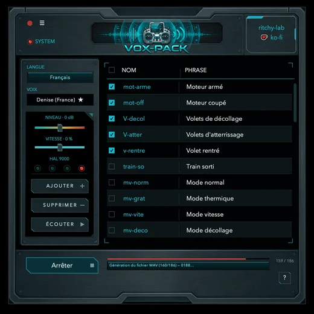 **Français** | 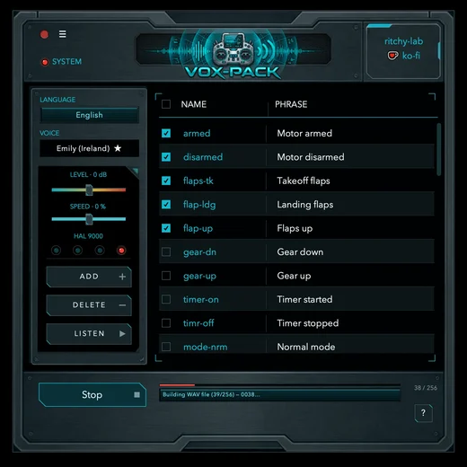 **English** | 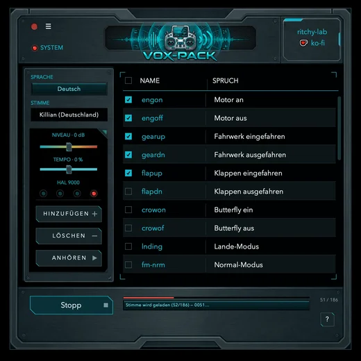 **Deutsch** |
| 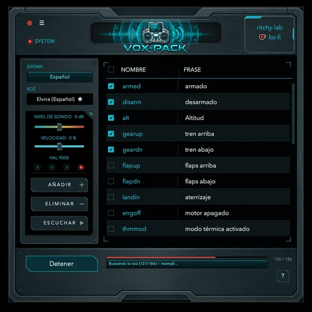 **Español** | 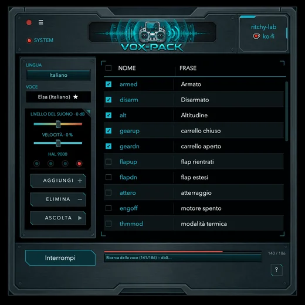 **Italiano** | 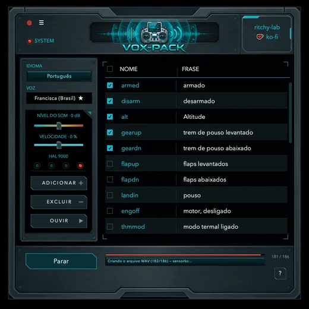 **Português** |
| 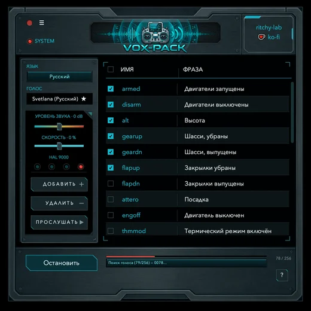 **Русский** | 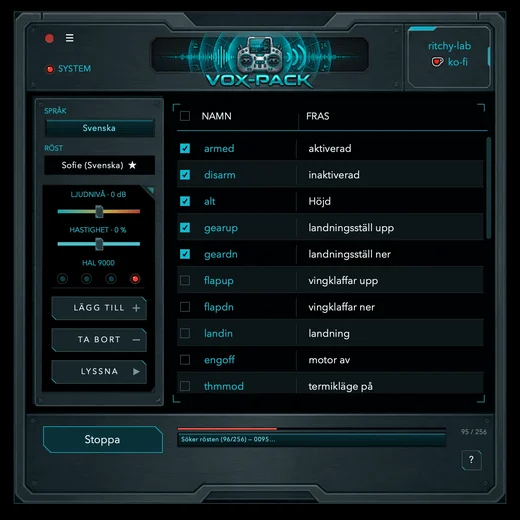 **Svenska** | 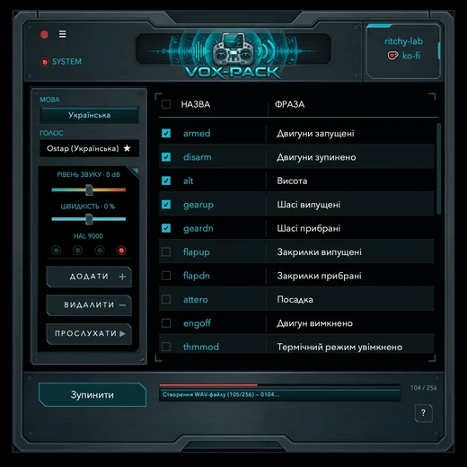 **Українська** |
| 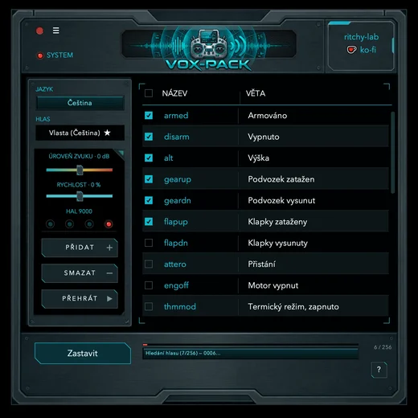 **Čeština** | 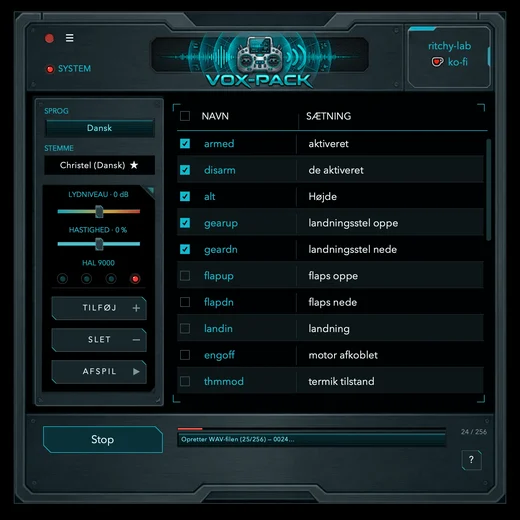 **Dansk** | 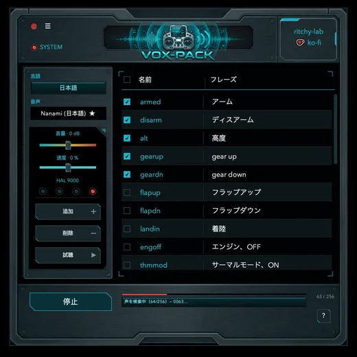 **日本語** |
| 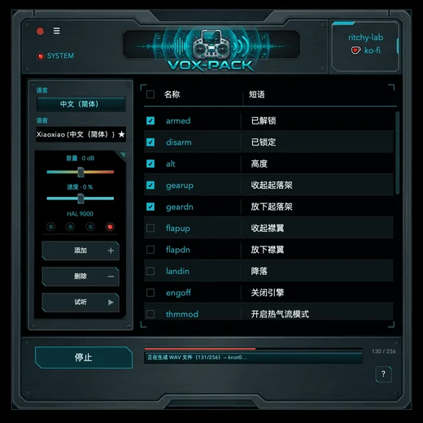 **中文（简体）** | 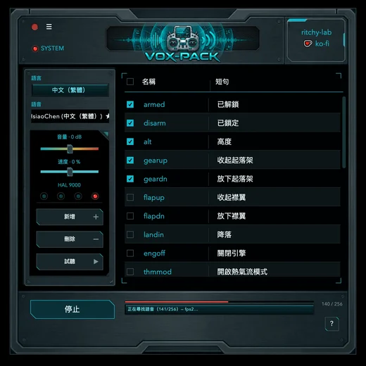 **中文（繁體）** |  **粵語（香港）** |

Les textes, les voix, la liste de phrases et le total des sons système changent
avec la langue. Les aides du japonais, du taïwanais et du hongkongais indiquent
qu'elles ont été traduites par une IA et n'ont pas été relues par un natif.
